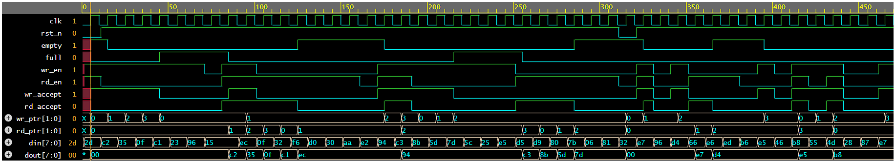

# Day 26: Build a Complete UVM Environment for Synchronous FIFO Verification

## Overview

This project builds a complete UVM-based verification environment for a synchronous FIFO using SystemVerilog.

The exercise starts with a new FIFO DUT and develops the verification environment step by step, including transaction modeling, stimulus generation, signal driving, monitoring, reference modeling, scoreboard checking, reset handling, and functional coverage.

The environment is subsequently extended with SystemVerilog Assertions (SVA), a separate assertion checker, `bind` integration, and waveform-based debugging.

The main objectives are to:

- Build a structured, reusable UVM verification environment.
- Verify FIFO read/write behavior against an independent reference model.
- Handle synchronous reset and FIFO boundary conditions correctly.
- Separate stimulus generation, signal driving, observation, prediction, and checking.
- Add interface-level temporal assertions without modifying the DUT.
- Use simulation logs, functional coverage, and waveforms to analyze verification results.

## 1. DUT Specification

The DUT is a parameterized synchronous FIFO instantiated with the following configuration:

| Parameter | Value |
|---|---|
| Data width | 8 bits |
| FIFO depth | 4 entries |
| Clock period | 10 ns |
| Reset | Active-low, synchronous |

### Interface signals

| Signal | Description |
|---|---|
| `clk` | Clock input |
| `rst_n` | Active-low synchronous reset |
| `wr_en` | Write request |
| `rd_en` | Read request |
| `din[7:0]` | Input data |
| `dout[7:0]` | Output data |
| `full` | Indicates that the FIFO is full |
| `empty` | Indicates that the FIFO is empty |

### Functional behavior

- A write is accepted when `wr_en` is asserted and `full` is deasserted.
- A read is accepted when `rd_en` is asserted and `empty` is deasserted.
- A write request to a full FIFO is rejected.
- A read request to an empty FIFO is rejected.
- Simultaneous read and write operations are accepted when both operations are individually valid.
- When a read is accepted, `dout` updates with the corresponding FIFO data.
- When a read is not accepted, `dout` retains its previous value.
- Reset clears the FIFO state, deasserts `full`, and asserts `empty`.

## 2. Verification Environment Architecture

The verification environment separates stimulus generation, DUT interaction, observation, prediction, and checking.

### UVM architecture

```text
fifo_tb
├── fifo_if
├── sync_fifo (DUT)
└── fifo_test
    └── fifo_env
        ├── fifo_agent
        │   ├── fifo_sequencer
        │   ├── fifo_driver
        │   └── fifo_monitor
        ├── fifo_reference_model
        └── fifo_scoreboard
```

The diagram illustrates the intended logical architecture. The actual source-file organization follows the implementation in the repository.

### Component responsibilities

| Component | Responsibility |
|---|---|
| `fifo_if` | Connects the DUT and testbench and defines driver and monitor clocking blocks. |
| `fifo_transaction` | Represents FIFO operations and the associated transaction data. |
| `fifo_sequence` | Generates stimulus transactions. |
| `fifo_sequencer` | Supplies transactions from the sequence to the driver. |
| `fifo_driver` | Drives DUT interface signals according to received transactions. |
| `fifo_monitor` | Samples interface activity and publishes observed transaction information. |
| `fifo_reference_model` | Predicts FIFO behavior independently using a software model of the FIFO contents. |
| `fifo_scoreboard` | Compares expected and actual behavior and reports mismatches. |
| `fifo_agent` | Groups the sequencer, driver, and monitor. |
| `fifo_env` | Instantiates and connects the verification components. |
| `fifo_test` | Configures and starts the test scenario and manages the UVM phase objection. |

## 3. Step-by-Step Development

### Step 1: Define the FIFO DUT and interface

A new synchronous FIFO DUT was introduced with configurable data width and depth.

The interface encapsulates the DUT signals and provides clocking blocks to define when the driver drives signals and when the monitor samples them.

The driver and monitor use the virtual interface supplied through `uvm_config_db`, allowing the UVM components to access the DUT interface without hardcoding the top-level hierarchy.

### Step 2: Introduce transaction-based stimulus

A transaction class was created to represent FIFO operations.

Instead of directly generating all pin-level activity inside the test, the sequence generates transaction objects, and the sequencer delivers them to the driver.

This establishes the transaction-level stimulus flow used by the UVM environment.

### Step 3: Implement the driver and monitor

The driver converts transactions into interface-level read/write activity.

The monitor observes the interface and collects the relevant request, data, and status information.

Clocking blocks help make the timing relationship between driving and sampling explicit, reducing the risk of race conditions between the testbench and synchronous DUT.

### Step 4: Build the reference model

The reference model maintains an independent representation of FIFO contents and predicts the expected behavior of accepted reads and writes.

It accounts for FIFO occupancy and boundary conditions, including rejected operations when the FIFO is full or empty.

The reference model provides expected results independently of the DUT's internal implementation.

### Step 5: Implement the scoreboard

The scoreboard receives expected and actual results and compares them to identify functional mismatches.

This allows the environment to detect incorrect FIFO behavior rather than relying only on simulation completion or visual waveform inspection.

### Step 6: Integrate the UVM environment and test

The agent, reference model, and scoreboard are integrated into the environment.

The test configures the virtual interface through `uvm_config_db`, starts the sequence on the sequencer, and manages the run-phase objection so that simulation continues while stimulus and checking are in progress.

### Step 7: Handle reset and clocking behavior

The testbench provides a clock and applies an active-low synchronous reset.

Reset handling is important because the DUT, monitor, reference model, and scoreboard must agree on when FIFO state is initialized and when normal transactions may be checked.

The interface clocking blocks also provide a consistent sampling strategy for observing the DUT's registered outputs.

### Step 8: Add functional coverage

Functional coverage is used to track FIFO states, operation types, and their combinations.

Coverage helps assess whether the stimulus has exercised the intended scenarios. It complements scoreboard checking, which determines whether observed behavior matches the expected results.

### Step 9: Add SVA and bind integration

After the UVM environment was established, a separate assertion checker was added in `fifo_assertions.sv`.

The checker is attached to the DUT using `fifo_bind.sv`, keeping the assertion implementation separate from the RTL.

This extension checks temporal properties of the FIFO interface without requiring modifications to the DUT.

### Step 10: Dump and inspect waveforms

Waveform dumping was added to the testbench to support debugging and visual inspection of signal timing.

The waveform is used to examine reset behavior, read/write requests, accepted operations, status transitions, and output data updates.

## 4. SystemVerilog Assertions

The separate SVA checker currently defines seven properties.

| Property | Verification goal |
|---|---|
| P1: Full/empty mutual exclusion | `full` and `empty` must never be asserted simultaneously during normal operation. |
| P2: Reset behavior | The FIFO must be empty and not full at the sampled clock following an active reset sample. |
| P3: Empty-state persistence | The FIFO must remain empty through the sampled cycle in which an accepted write request occurs. |
| P4: Write to empty FIFO | An accepted write to an empty FIFO must cause `empty` to be deasserted at the next sampled clock. |
| P5: Accepted write | An accepted write must cause the FIFO to become non-empty at the next sampled clock. |
| P6: Accepted read | An accepted read must cause the FIFO to become non-full at the next sampled clock. |
| P7: Simultaneous read/write | Simultaneously accepted read and write operations must preserve the `full` and `empty` flags. |

The assertions use `disable iff (!vif.rst_n)` for normal-operation checks that should be disabled during reset. P2 intentionally does not use this disable condition because it checks reset behavior.

The SVA checker complements the reference model and scoreboard. The reference model predicts expected functionality, the scoreboard compares expected and actual behavior, and SVA expresses selected temporal requirements directly.

## 5. Waveform Debugging

The testbench generates a VCD waveform for inspection.

The waveform includes the clock, reset, FIFO control signals, accepted-operation indicators, status flags, and data signals.

### Waveform screenshot

Save the screenshot in this directory as `fifo_waveform.png`.



### Signals of interest

| Signal | What to inspect |
|---|---|
| `clk` | Sampling and state-update timing |
| `rst_n` | Reset assertion and release |
| `wr_en`, `rd_en` | Read/write requests |
| `wr_accept`, `rd_accept` | Whether the corresponding operations are accepted |
| `full`, `empty` | FIFO status transitions |
| `din` | Input data presented for writing |
| `dout` | Data returned by accepted reads |

Waveform inspection is particularly useful for understanding the relationship between requests, accepted operations, and registered state changes.

## 6. Simulation Results

The current simulation was run using Synopsys VCS X-2025.06-SP1_Full64 with UVM 1.2.

| Metric | Result |
|---|---:|
| Total scoreboard checks | 47 |
| Passed checks | 47 |
| Failed checks | 0 |
| FIFO state coverage | 100% |
| Operation coverage | 100% |
| FIFO state × operation coverage | 100% |
| UVM warnings | 0 |
| UVM errors | 0 |
| UVM fatals | 0 |
| Simulation end time | 470 ns |

The simulation completed successfully, and the scoreboard reported no mismatches.

The reported coverage values describe the coverage model used in the current test. They do not imply that every possible FIFO sequence, assertion failure path, or corner case has been exhaustively verified.

## 7. Key Learning Outcomes

- Building a complete UVM verification environment around a new DUT.
- Using transactions, sequences, sequencers, drivers, and monitors to separate stimulus generation from pin-level activity.
- Connecting UVM components through an environment and agent.
- Implementing an independent reference model and scoreboard.
- Handling virtual interfaces, `uvm_config_db`, clocking blocks, and reset behavior.
- Using functional coverage to assess stimulus scenarios.
- Writing temporal assertions using `|->`, `|=>`, `until_with`, and `$stable`.
- Attaching an assertion checker with `bind` without modifying the DUT.
- Using waveform inspection to understand synchronous FIFO behavior and debug timing issues.

## 8. Future Improvements

- Exercise each assertion's failure path to confirm that violations are detected.
- Review reset-release sampling and temporal assertion semantics.
- Add directed tests for FIFO boundary conditions, including reads while empty, writes while full, and simultaneous read/write operations at different occupancy levels.
- Extend functional coverage when additional scenarios are introduced.
- Continue improving the verification environment while keeping the DUT, UVM components, reference model, scoreboard, and SVA checker logically separated.
